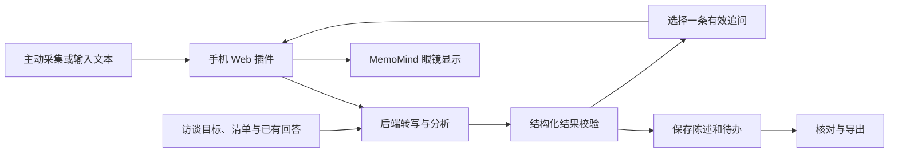

# 问全 · 面对面访谈的实时追问助手

> 访谈结束才发现漏问，已经太晚。问全在交流现场提醒你：下一句最值得问什么。

版本：v0.4 · 通用访谈产品叙事与黑客松开发基线  
日期：2026-10-17  
载体：MemoMind 智能眼镜＋手机端 Web 插件＋后端服务  
项目阶段：已完成公开资料调研、方案设计和用户提供的 Android APK 静态检查；尚未完成产品开发、App/眼镜真机联调、模型对照测试及真实用户验证。

## 1. 项目概述

**问全是一款面向有明确目标的面对面访谈的实时追问助手。** 访谈者在手机上写下这次想弄清什么，可以补充或修改待确认清单；交流时主动采集一段对话。系统对照目标和已经听到的回答，找出仍未提及、回答含糊或互相矛盾的事项，从中选出一条适合此刻提出的问题，显示在 MemoMind 眼镜上。手机端保留原话和建议依据，供访谈者判断、纠正与会后整理。

项目解决的共性问题是：访谈者一边倾听、一边理解和记录时，容易把含糊回答当成完整答案，或在谈话结束后才想起关键问题没有问。录音与摘要保留“说过什么”；问全要在还来得及追问的时候指出“为了这次访谈的目标，还缺什么”。

产品内核是**访谈目标 → 待确认事项 → 判断回答是否足够 → 选择一条追问 → 保留原话依据**。它适用于用户研究、客户需求发现、新闻采访、招聘面试等不同场景；场景模板改变要问的内容，不改变底层流程。48 小时原型以 **AI FDE 驻场需求访谈**作为第一个深度模板和主舞台，再用一个用户研究访谈验证同一套代码能处理不同目标。底层采用可替换的通用文本模型，Jev 不是项目依赖。

### 一句话介绍与演示主张

> 问全让你在面对面访谈中少漏掉关键问题：你负责倾听和判断，它在眼镜上只提醒一条有依据的追问。

黑客松演示先让观众看到一个真实的遗漏：对方说“投诉件找主管”，访谈者通常会继续下一个话题；问全根据访谈目标提示“主管联系不上时怎么办”。随后切换成用户研究清单，在同一套界面和判断流程下追问“不太好用”具体发生在哪一步。**FDE 证明问题有价值，第二场景证明产品不是 FDE 专用。** 两段都是设计脚本，实际效果需以运行结果为准。

### 项目目标

- 让访谈者在当前交流中及时识别与本次目标有关的重要缺口。
- 将建议追问与具体原话、缺少的条件联系起来。
- 让跨多次访谈的回答、分歧和后续行动可以持续核对。
- 验证眼镜提示在面对面交流中的可用性，以及它相较手机提示的实际收益。

### 当前已知条件

| 项目 | 当前状态 |
|---|---|
| 开发时间 | 黑客松约 48 小时 |
| 真机 | 用户表示开发期间可以获得 MemoMind 真机；本项目链路尚未实测 |
| 前期材料 | 已有平台开发文档、FDE 调研、访谈手册和模型替代方案；FDE 材料用于首个模板，不限定产品服务范围 |
| 团队规模 | 尚未确定，任务按职责拆分，可由同一人兼任 |
| 赛事规则 | 尚未提供，是否指定模型、部署或提交方式仍需核对 |
| 模型与语音服务 | 尚未选定；根据实际可用账户及测试结果选择 |
| 配套 App 证据 | 用户提供的 Android APK 内标识为 MemoMind `1.3.81`（versionCode `119`）；仅做静态检查，来源签名、当前账号权限及真机能力未核对 |
| GitHub 仓库 | [wenquan-interview-copilot](https://github.com/miaodaxia80-droid/wenquan-interview-copilot) 已创建为公开仓库，仅有空 `.gitkeep` 初始提交；本地项目文档尚未上传 |

## 2. 用户、场景与痛点

### 2.1 核心用户

目标用户是需要带着明确目的与他人交流、又不能频繁低头查看清单的人，例如用户研究员、记者、招聘面试官、咨询顾问、销售发现访谈者，以及 AI FDE。产品服务的是**访谈者的提问过程**，不替他们做最终事实判断、人员评价或业务决策。不同访谈的敏感程度、允许记录的方式和提问边界不同，由使用者在现场确认。

48 小时原型优先找 AI FDE 或实施工程师验证高价值场景：他们既要问清业务规则，又要把答案用于后续交付。FDE 是首个模板和早期用户群，不是唯一用户或产品定义。

访谈对象角色影响问题选择：客户主管与一线员工能回答不同问题，候选人与招聘方也一样。系统不能把某位受访者的猜测自动当作全局事实。

### 2.2 核心使用场景

通用流程是：访谈者先明确目标与待确认项，谈话中主动采集片段，问全在尚未解决的项中选一条适合此时提出的问题。产品不能凭空知道某场访谈的“关键问题”是什么；它必须依据用户给定的目标、清单、受访角色和已经说过的话判断。用户可随时修改目标和清单，或忽略提示。

| 场景 | 本次要弄清什么 | 含糊回答后可追问什么 |
|---|---|---|
| 用户研究 | 用户上次放弃报名的具体经过 | “你停在了哪一步？” |
| AI FDE 需求访谈 | Agent 能做什么、遇到例外如何处理 | “主管联系不上时，投诉件由谁处理？” |
| 记者采访 | 一项说法的发生时间与可核对来源 | “这件事发生在什么时候？你是亲历还是转述？” |
| 招聘面试 | 候选人在某个项目中实际承担的工作 | “这个结果里，哪部分是你亲自负责的？” |

表中问句仅为设计示例。招聘场景只辅助追问具体经历，不自动评分、筛选或替人作录用决定。

首个深度演示为 FDE 为企业开发售后工单 Agent：主管提出“自动处理工单”，一线员工补充实际例外，系统负责人说明接口限制。工程师需要把答案转化为范围、执行边界、开发依赖和评估案例。第二个简短演示采用用户研究访谈，针对“上次放弃提交报名表的具体步骤和原因”追问，检验没有 FDE 专用规则时是否仍能工作。若第二场景失败，就不能宣称通用性已被验证。

产品贯穿三种活动：

1. 会前准备：说明本次要弄清什么、向谁问、哪些问题必须核对。
2. 会中追问：对照已有回答，只提示一条仍值得问的问题。
3. 会后与续访：保留依据、待确认项和不同人的说法，按场景导出记录。

### 2.3 待验证的用户痛点

| 痛点假设 | 具体表现 | 可能后果 |
|---|---|---|
| 同时听、理解、记录有负担 | 听到关键回答后忘了追问条件或具体事例 | 会后才发现无法使用这段回答 |
| 模糊答案看起来像完整答案 | “不太好用”“还可以”“数据都有” | 原因、经历或可执行条件仍不明确 |
| 访谈对象的知识和权限不同 | 把个人经历、转述或猜测误当成已核实事实 | 记录失真，后续判断失准 |
| 跨访谈上下文丢失 | 后来的期望覆盖了之前的经历或当前限制 | 结论矛盾且难以追溯 |
| 会后记录无法推进工作 | 有摘要，却不知道哪些问题仍未回答、应找谁确认 | 需要反复联系受访者 |

以上尚未经过真实用户研究验证，不能对外宣称已减少返工或节约某个比例的工时。

## 3. 产品定位与价值

**产品承诺：帮助访谈者发现当前目标下还没问清的事项，提供可忽略的一条追问，并保留依据。**

| 常见能力 | 问全增加的工作 |
|---|---|
| 转写和会议摘要 | 对照访谈目标，指出哪一项还没问清，以及为什么 |
| 静态访谈清单 | 根据当前话题、回答和角色选择此刻值得问的一项 |
| 单次问答 | 结合本主题已有陈述，跟踪修正和待核对差异 |
| 待办记录 | 将待确认事项关联到原话、缺口、受访角色和下一步 |

在用户提供的 MemoMind Android APK 中，可以看到录音/离线识别组件、AI 字幕与录音摘要的实现线索。因此不能把“能转写、能生成摘要”本身作为项目新颖性。问全的差异要通过同一段访谈具体展示：FDE 场景中，普通记录留下“投诉件找主管”，问全指出“主管未响应时怎么处理”仍未知；用户研究场景中，普通记录留下“不太好用”，问全追问“上次卡在哪一步”。两者都给出可核对的原话。APK 静态证据不代表这些 App 功能在所有账号和设备上已开放。

眼镜的预期价值是减少低头查手机的需要，在交流自然停顿时提供短提示。这是体验假设，必须测试可读性、打扰程度和受访者接受度。手机承担目标编辑、原话查看、纠错和会后整理。**眼镜是现场提示界面，手机是配置与核对界面。**

## 4. 用户使用流程

### 4.1 会前准备

用户在手机上创建访谈主题，用一句话写明本次目标和受访角色。系统可提出几条**候选**待确认项，用户确认、删除或改写后再开始；也可以直接从空白清单或场景模板开始。首版提供 FDE 需求访谈模板，但非 FDE 场景无需选模板。目标或清单为空、过于宽泛时，界面先引导用户补充，避免生成看似聪明却与目的无关的追问。

示例：

- 访谈主题：售后工单 Agent。
- 本次目标：确认第一版分派流程及人工处理边界。
- 当前对象：客服主管。
- 重点未知：AI 是否能直接修改工单、投诉件如何升级、怎样验收。

界面提醒用户确认现场允许的记录方式。未采用录音时，可手动输入文本继续使用。

### 4.2 会中采集与追问

用户主动开始并结束一个对话片段。系统完成转写后，展示可编辑文本，结合已知状态分析。

眼镜一次最多显示一条建议，例如：

> 建议追问  
> AI 是给分派建议，还是直接修改工单？

用户可以采用、跳过、稍后处理或暂停提示。标记“已问”只表示问题已提出，不表示已经获得答案；下一段对话分析后才能更新相关信息状态。

首版默认以手机操作触发采集与分析，眼镜负责显示。眼镜按键触发作为真机验证通过后的增强功能，避免关键流程依赖未确认的输入映射。

### 4.3 查看依据与更正

手机显示这条提示对应的原话、缺少的条件及适合确认的角色。用户可以修改错误转写或角色，系统重新分析受影响的内容。

若已经回答清楚，用户可手动标记并填写依据。保留修改记录，避免旧分析结果覆盖新状态。

### 4.4 会后整理与跨会续接

用户结束访谈后，查看并编辑访谈记录，导出 Markdown 文件。下次进入同一主题，可以看到尚未解决的问题及来源。

通用导出包括：本次目标、访谈中已有的具体陈述、仍未解决的问题、受访者原话与后续行动。它区分“对方已经说明”和“事实已经核实”。FDE 模板额外整理当前流程、第一版范围草案、AI 执行边界、待确认规则、所需材料与候选测试案例。

草案需由相关人员核对。模型不能代替受访者确认事实；在 FDE 场景也不能代替企业确认范围、审批权限或验收结果。

## 5. 功能需求与优先级

### 5.1 P0：48 小时内的核心版本

| 编号 | 功能 | 行为与完成条件 |
|---|---|---|
| F01 | 主题和访谈设置 | 可创建主题、写明目标与受访角色；模型给出可编辑的候选待确认项，用户也可从空白清单或 FDE 模板开始 |
| F02 | 片段输入 | 完成一种真实语音采集到转写的路径；同时支持文本录入与更正 |
| F03 | 信息状态更新 | 用户清单中的每一项可显示未提及、模糊、具体陈述或待核对差异；FDE 模板预置六项 |
| F04 | 单条追问 | 从当前缺口选择一条问题；允许返回无提示 |
| F05 | 原话依据 | 每条新增陈述可以定位到输入段ID和原话 |
| F06 | 眼镜显示 | 在真机显示、替换、清空短提示；手机同步显示状态 |
| F07 | 用户反馈 | 支持已问、跳过、稍后处理、暂停提示；已问不自动解决缺口 |
| F08 | 主题续接 | 保存多次访谈记录，后续陈述不静默覆盖旧结论 |
| F09 | 会后导出 | 导出可编辑的访谈记录；FDE 模板增加项目发现字段，未知对象和期限保持空白 |
| F10 | 错误恢复 | 分析失败不更新事实，支持重试；断连时手机可继续工作 |

### 5.2 P1：核心链路稳定后增加

- 眼镜按键触发与提示操作。
- 根据场景整理候选测试案例或访谈发现，交由用户审阅。
- 更多角色与场景模板；通用清单复用与自定义问题排序。
- 已授权的背景资料导入及相关内容检索。
- 访谈后整体复核，检查跨片段遗漏与修正。

### 5.3 后续探索

跨主题可复用的问题库、团队协作、行业部署，以及与任务或知识库工具的集成。是否投入取决于真实使用结果。

首版不规划全天持续监听、自动多人身份识别、摄像头理解、直接操作受访者或客户的系统、自动生成已获批准的正式结论。

## 6. 通用访谈内核与 FDE 模板

### 6.1 通用目标清单

每场访谈都有一个用户确认的“待确认项”清单：要弄清的问题、为什么重要、适合询问的角色，以及可选的完成标准。用户可自行填写，也可先给一句话目标，让模型生成几条候选项后逐条审核；模板只是另一种初始草案。程序统一追踪每项的状态与原话依据；模型根据当前对话补充分析、建议追问或承认仍未知。清单中没有的内容可以作为“意外发现”记录，但不能擅自改写用户的访谈目标。

通用处理链为：目标 → 用户确认清单 → 片段转写/文本 → 对照已知回答 → 标记已有具体陈述、含糊或待核对 → 选一条当前最值得问的问题 → 用户反馈 → 会后记录。场景模板只提供初始问题和导出字段，不替换这一内核。没有足够信息时可以不提示，不能为了显示内容而编造缺口或原话。

### 6.2 首个深度模板：FDE 需求访谈六个维度

| 维度 | 需要核对什么 | 典型缺口 |
|---|---|---|
| 真实流程 | 触发、输入、步骤、交接、结束条件 | 不知道谁接收结果 |
| 规则与例外 | 判断依据、适用范围、异常与补救 | 只有正常处理规则 |
| 数据与知识 | 来源、样例、更新、所有者 | 仅说明“有数据” |
| 系统依赖 | 读取/写入、接口、环境、协调对象 | 未确认访问方式 |
| 执行与人工边界 | AI 可做动作、审批、接管、超时 | 有审批人但无超时规则 |
| 验收条件 | 样例、参考结果、指标口径、确认对象 | 只有未定义的准确率 |

业务目标和第一版范围作为 FDE 模板设置与会后汇总信息保留。这六个维度是**模板默认项**，用户可以删改；它们不能代表所有企业需求，更不能当作所有访谈都必须填写的字段。

### 6.3 按机制触发追问：FDE 模板示例

| 对话涉及 | 需检查的条件 | 示例问题 |
|---|---|---|
| 人工审批 | 无人响应、超时、拒绝后处理 | 审批人未回复时，这件事怎样继续？ |
| 知识检索 | 来源冲突、版本、过期 | 两份资料说法不一致时，以哪份为准？ |
| 系统写入 | 权限、失败、重复执行 | 请求超时后，怎样确认是否已经写入？ |
| 自动分类 | 未知类别、信息缺失 | 无法确定类别时，现在由谁处理？ |
| 跨部门交接 | 接收条件、退回 | 对方在什么情况下会把任务退回来？ |
| 质量指标 | 判据、样例、不同错误后果 | 哪类错误即使总体达标也不能接受？ |

以上是 FDE 模板的设计示例，不是模型实测输出。其他访谈使用其清单与目标生成问题，例如用户研究应追问具体经历而非企业验收标准。程序先排除已回答、已跳过且无新增依据、角色不适合的问题，再按当前话题与该项的重要性排序。只在用户请求时分析，首版不做自动连续打断。

### 6.4 信息状态

完整性、陈述类型和证据状态分开保存。

- 完整性：未提及、模糊、已有具体陈述、存在待核对差异。
- 陈述类型：当前做法、未来期望、假设、明确否定、不知道。
- 证据：口头陈述、关联材料、用户核对；模型不能自动升级为已核实事实或正式批准。

例如“现在不允许 AI 关闭工单”和“以后希望自动关闭”可以同时成立。新旧说法不同，应先核对适用范围、时间与角色；存在明确修正时建立版本关系。

## 7. 手机与眼镜交互

### 手机端四个主要页面

1. 主题页：访谈主题、最近访谈与未决事项。
2. 访谈准备页：目标、角色、可编辑待确认清单、场景模板和采集方式。
3. 访谈进行页：录音/文本、建议追问、原话依据和清单状态。
4. 访谈结果页：通用访谈记录、差异、后续行动、导出和续接；FDE 模板附流程与范围草案。

### 眼镜端

只显示状态短语和一条问题，避免完整纪要、长表格或同时排列多个建议。问题长度以真机可读性测试调整。显示状态包括：待命、处理中、建议追问、已暂停；错误详情放在手机。

用户看到问题后可继续看着对方交流。新结果到达前检查是否已经过期；手机已解决的问题不应再次推送。暂停或结束访谈时清空提示。

## 8. 技术方案

### 8.1 总体架构

### 8.2 各端职责

| 部分 | 建议实现 | 职责 |
|---|---|---|
| 手机 | TypeScript Web 插件，运行于 MemoMind App | 主题与访谈设置、采集控制、记录查看、修正、眼镜通信 |
| 眼镜 | 优先使用已有 Web Bridge 的显示能力 | 显示短提示；输入交互在真机通过后接入 |
| 后端 | 轻量 TypeScript 服务 | 转写服务调用、模型调用、引用校验、状态更新 |
| 数据 | 首版采用简单持久化存储 | 按主题与访谈保存目标清单、文本、陈述、问题、行动和版本 |
| 文本模型 | 一个可用且支持结构化输出的模型 | 提取、判断、生成候选追问 |
| ASR | 选择已可用的语音转写服务 | 将采集音频转换为带段ID的文本 |

这是一套建议实现，尚未据此建立工程。手机端“应用”指官方 App 内的 Web 插件，首版不另造完整原生 App。用户提供的 Android APK 包含开发者工作台资源和一份 `web_bridge.gmp`，支持优先验证这条路线；但内置 Bridge 与本地 SDK 构建产物的二进制内容不同，兼容性、入口开放情况和显示效果必须以实际导入、授权及真机验证为准。APK 不提供 iOS 端能力的证据。

眼镜音频采集、解码、上传及识别是关键不确定链路。先依据本地 SDK 示例验证格式和支持情况，不把录音 API 存在等同整条转写链已打通。APK 内有 App 自身的离线 ASR 模型与录音服务，**不能推断第三方 Web 插件可以读取其识别结果**；首版按公开接口完成自有采集与转写，或使用明确标注的文本/预录音频模式演示。也要测试 App 自带字幕、录音与插件是否争用音频或眼镜显示。

### 8.3 模型选型

首版优先接入已有调用条件的通用文本模型。可从千问、GPT、Claude、Gemini 等支持所需结构输出的具体型号中选一到两个候选；DeepSeek 也可通过 JSON 输出加程序校验参与比较。不同服务支持条件需实施时核对。

不以品牌、模型自报置信度或结构合规作为效果证明。保留统一的输入输出结构，方便后续替换；Jev 可作为未来局部判断模块对照，不影响主要架构。

### 8.4 单次分析输入与输出

输入：用户确认的访谈目标与待确认清单、当前角色、相关已知陈述、带 ID 的转写片段、未决项、已问/跳过问题、可选场景模板。清单草案生成与会中追问分析分开调用；前者需用户确认，后者不能自行新增必答目标。

输出：新增或修正陈述、原话引用、具体缺口、候选问题、可选的一条建议、后续行动。

模型输出后由程序检查字段、段ID、引文、版本和候选状态。没有足够依据时保留未知，允许返回无建议。对话文本只能作为分析资料，不能修改应用的系统指令。

### 8.5 最小数据对象

| 对象 | 必要内容 |
|---|---|
| Topic | ID、名称、场景模板、背景与长期目标 |
| Session | ID、主题ID、本次目标、受访角色、开始/结束时间 |
| ChecklistItem | ID、访谈ID、待确认问题、重要性、适合角色、可选完成标准、状态 |
| TranscriptSegment | ID、访谈ID、序号、原始文本、修正文本、来源方式 |
| Claim | 字段、陈述、类型、完整性、引文、来源段、版本关系 |
| Gap | 缺少条件、相关陈述、影响、适合确认的角色、状态 |
| Question | 关联缺口、文字、生成依据、展示/已问/跳过状态 |
| Action | 所需材料或确认、协调对象、确认对象、明确约定的期限 |

原话存在仅能证明引用来源，仍需检查模型是否正确解释。原话和用户更正分开保留；未明确的姓名、日期或权限不得补造。

## 9. 可靠性与数据处理

- 结构不合法、请求失败或结果截断时，不更新陈述状态，支持有限重试与手动继续。
- 每次分析带片段序号和状态版本，晚到的旧结果不得覆盖新记录。
- 修改转写后重新核对受影响的结论，撤回对应过期提示。
- 主题间隔离；当前模型上下文只包含该主题与本次访谈必要信息。
- API 密钥放在后端，客户端不持有服务端密钥。
- 显示明确的采集状态，提供停止、文本模式与删除记录操作。
- 默认只保留续访所需的文本和结构化记录；音频临时处理与清理策略在实现中明确，不能宣称已做到本地处理或零留存。
- 演示使用虚构或脱敏材料；实际客户使用前确认允许的设备、录音与处理环境。

## 10. 48 小时开发计划

以下为建议排期，不是已完成进度。职责可由同一人兼任。

| 时间 | 目标 | 主要产出 | 决策点 |
|---|---|---|---|
| 0–6h | 验证最难的连接 | 记录手机系统/App/固件版本；确认开发者工作台导入、授权与真机文字显示/清空；一次真实结构化模型调用；验证插件采集到转写 | App 内置 ASR 不算插件语音链已打通；音频链受阻时立即采用文本备选 |
| 6–16h | 建立通用分析闭环 | 手机基本页面、一句话目标生成候选清单并由用户确认、陈述与引文保存、单条追问 | 自定义清单能从输入得到可追溯的结果 |
| 16–26h | 接真实交互 | 语音路径、眼镜更新/清空、跳过/暂停、错误恢复 | 连续完成一场短访谈 |
| 26–34h | 跨会续接和导出 | 第二场访谈、修正/差异、行动清单、Markdown 导出 | 新说法不静默覆盖旧记录 |
| 34–42h | 检查判断与通用性 | FDE 与另一类访谈各跑一个完整片段，加入否定/假设/修正测试及真机试用 | 优先修复未解决误判为解决，并排查 FDE 硬编码 |
| 42–48h | 稳定演示与交付 | 固定版本、现场脚本、运行说明、演示备份与实测记录 | 按实际完成情况展示，区分实时与预录模式 |

建议职责分配：A 负责手机/眼镜和采集；B 负责后端/模型/状态；C 负责 FDE 与第二场景材料、标注、验收和路演。人数不足时合并职责，并先削减 P1 功能。通用性由用户确认的清单与共用分析流程保证，不要求 48 小时内做大量行业模板。前 6 小时若真机显示或音频链路受阻，仍要保留可运行的手机端追问闭环，并在演示中准确说明缺口。

## 11. 演示脚本

全部对话为虚构设计示例，模型输出需要实际运行验证。开场先展示同一个手机界面可以输入不同访谈目标、生成并修改待确认清单；FDE 是完整主演示，用户研究访谈用于验证同一内核可迁移。讲解时只展示一次“目标 → 原话 → 信息缺口 → 眼镜追问 → 手机依据”的过程，不把两个场景包装成两套产品。

### 第一幕：含糊诉求

主管：“想让 AI 自动处理售后工单，分到对应小组，越快越好。”

系统应识别执行边界未明确。眼镜候选问题：“AI 是给分派建议，还是直接修改工单？”

### 第二幕：补充规则后继续追例外

主管：“第一版先建议，由值班同事确认。投诉件找主管。”

系统记为已有具体陈述，并保留原话。接下来可以问：“主管暂时联系不上时，投诉件怎么处理？”

### 第三幕：第二位对象补充实际情况

一线：“有些工单标签写普通咨询，正文却是重复投诉，还要查历史记录。”

系统增加条件与数据依赖，提示：“标签和正文不一致时，目前按什么判断？”

### 第四幕：形成可以推进的记录

对方：“历史记录能否接给你们，需要找 IT 确认。”

手机形成待办：确认历史工单查询方式、访问范围和可用样例；责任人姓名和期限未知则留空。导出记录保留第一版人工确认边界、待核对规则和候选异常测试案例。

展示重点是每次新增信息怎样改变理解，以及每条追问依据来自哪里。不能依靠硬编码展示结果宣称模型已实时理解。

### 第二场景：用户研究访谈（简短验证）

访谈目标：理解用户上次放弃提交报名表的原因。待确认项由用户手动设置为“发生在第几步”“当时想完成什么”“尝试过什么”“为何最终放弃”。受访者只说：“那个报名表不太好用，我就没填了。”系统保留该主观评价，但不把原因标记为已确认；眼镜可建议：“你上次是填到哪一步停下来的？”

这段与 FDE 场景必须共用输入、状态判断、引文和单条追问代码；只有目标清单与导出标题不同。它是产品设计示例，不能在未运行时称为模型实测。

## 12. 验收与评估

### 12.1 功能验收

| 检查 | 通过条件 |
|---|---|
| 完整闭环 | 在真机上从真实输入得到一条可追溯的提示，手机可查看依据 |
| 低门槛开始 | 用户只写一句话目标时能得到可编辑的候选清单；未经用户确认的候选项不作为既定目标 |
| 通用性 | 同一实现能分别加载 FDE 模板和自定义非 FDE 清单，产生与各自目标相关的问题；不依赖写死的售后工单关键词 |
| 空结果 | 没有值得追问的问题时返回无建议，不强行编问题 |
| 否定与期望 | “不允许自动关闭”不被识别为允许；未来愿望不覆盖当前规则 |
| 用户反馈 | 已问不等于已解决，跳过与暂停确实影响后续提示 |
| 修正与续接 | 第二次访谈保留来源，明确修正有版本关系 |
| 引用 | 所有接受的陈述引用都能在对应输入中定位 |
| 错误恢复 | 模型失败、断连和旧结果晚到不会破坏已有状态 |
| 导出 | 记录可读，草案/未知明确标注，无虚构负责人或期限 |

### 12.2 模型评估

准备 30–50 个中文片段作为首轮查错集，至少覆盖 FDE 与用户研究两类目标，以及模糊回答、具体回答、否定、假设、不知道、后续修正、角色范围差异、真正冲突、转写错误、已问问题和未说完。调试集与最终检查集分开，规则预先固定。

优先记录“未解决误标为已解决”，其次是漏认答案、无依据判断、重复追问、角色不适配和把 FDE 术语错误带到其他场景。另请人判断追问是否具体、是否适合当前对话，而非只看模型输出是否符合 JSON 格式。报告真实样本数与错误数，不用小样本宣称整体准确率领先。

延迟从用户结束片段开始，计到眼镜实际显示，记录中位数及较慢请求；成本统计转写、模型输入/输出、重试与会后分析。目前不承诺尚未测试的数值。

### 12.3 产品验证

分别邀请有客户交付经历和另一类访谈经历的人审阅对应材料，比较普通转写/清单与问全能识别的关键未知，并观察不合适提醒的数量。再比较手机提示与眼镜提示的低头次数、阅读负担和主观干扰。

通过技术验收只说明原型可运行。对真实工作减少返工、用户愿意持续使用和支付等结论，需后续验证。

## 13. 主要风险与应对

| 不确定性 | 影响 | 首版应对 |
|---|---|---|
| 采集与转写链路 | 无法实时取得对话 | 最先验证；保留文本入口，清晰标注演示模式 |
| App 内置能力与插件能力混淆 | 错把录音、离线 ASR 或摘要当作公开可调用接口 | 以 SDK 契约和真机插件调用为准；不依赖未公开内部接口 |
| App 既有功能覆盖基础卖点 | 转写/摘要演示难体现项目价值 | 同段访谈对比信息缺口、原话依据和下一条追问；只声明自己实现的部分 |
| 中文与否定句判断 | 把未解决标为解决 | 场景化测试、原话核对、人工纠正 |
| 提醒打断交流 | 用户忽略或停用 | 主动触发、一次一条、可暂停 |
| 多角色信息被混合 | 不同适用条件被误认成冲突 | 首版手动选择角色，记录范围和来源 |
| 现场不允许设备或云服务 | 无法使用 | 提前确认，保留手动文本流程；内网方案后续评估 |
| 模型服务波动 | 结果迟到或失败 | 超时、版本校验、重试和无提示状态 |
| 通用化过早导致问题空泛 | 每类访谈只得到套话 | 用用户确认的具体目标与清单约束追问；先做好 FDE 深度模板，再用第二场景检验迁移 |
| 用户痛点不够强 | 技术做成但缺少持续需求 | 接触至少两类实际访谈者，观察他们当前如何补信息 |

## 14. 待确定事项与开发交付物

开工时优先确定：团队人数、实际手机系统与 App/固件版本、开发者工作台账号入口、可用模型与转写账户、赛事是否有指定技术要求，以及可参与验证的交付人员。其余页面细节和提示长度可在原型中迭代。

黑客松应交付：

- 可运行的手机 Web 插件及可复现的眼镜联调方式。
- 后端服务与不含密钥的配置示例。
- 虚构/脱敏的 FDE 主场景与非 FDE 验证场景材料、固定脚本。
- 功能与模型测试记录，标明实测范围和剩余问题。
- 项目说明、运行步骤和一份真实导出的发现记录。
- 对实时输入、预录输入、模拟器与真机能力作清楚标注的展示材料。

## 15. 依据与延伸材料

本文件将前期研究收敛为项目设计，功能和排期为建议，非厂商要求。

- [FDE 工作模式与真实从业者调研](./FDE驻场访谈研究_2026-10-16/FDE工作模式与真实从业者调研.md)
- [不用 Jev 的模型方案](./FDE驻场访谈研究_2026-10-16/不用Jev的模型方案.md)
- [现场访谈手册与采集模板](./FDE驻场访谈研究_2026-10-16/现场访谈手册与采集模板.md)
- [MemoMind 开发文档](./MemoMind开发文档.md)
- [MemoMind Android APK 静态检查](./MemoMind_APK静态检查_2026-10-16.md)：针对用户提供的 `1.3.81` 安装包；仅说明内置证据与未验证边界。
- [Nabeel Qureshi：Reflections on Palantir](https://nabeelqu.co/reflections-on-palantir)：现场业务理解与数据协调的一手回忆。
- [Cresta：Hanze Li 访谈](https://cresta.com/blog/cresta-crew-hanze-li-forward-deployed-engineer)：场景例外、方案取舍和评估实践。
- [PostHog FDE 公开手册](https://github.com/PostHog/posthog.com/blob/master/contents/handbook/forward-deployed-engineering/how-we-work.md)：范围、执行、收尾与产品反馈。
